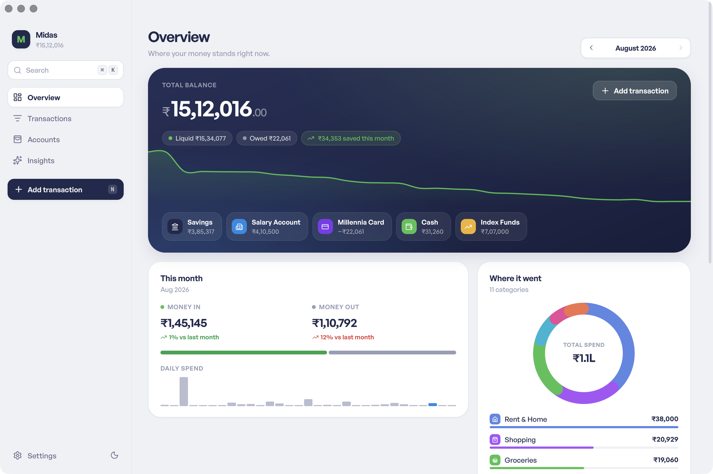

# Midas

A local-first expense tracker for macOS — Tauri 2 + React 19 + SQLite, built to
Fold's design language (₹ INR, Indian digit grouping).



## Running it

```bash
yarn install
yarn tauri dev      # dev, with HMR on the React side
yarn tauri build    # signed .app / .dmg into src-tauri/target/release/bundle
```

The first launch seeds a sample book — about thirteen months of realistic
history across five accounts — so there's something to look at. Wipe it from
**Settings → Your data**.

## What it does

Three kinds of transaction, which is the whole model:

| Kind | Moves | Categorised |
|------|-------|-------------|
| **Income** | into one account | yes |
| **Expense** | out of one account | yes |
| **Transfer** | between two of your own accounts | no — it's internal, so it nets to zero |

Accounts come in five flavours (bank, credit, cash, wallet, investment). A
credit card's balance goes negative as you spend and the card screen labels it
*Outstanding* rather than *Balance*; give it a credit limit and the card also
shows how much is left and how much of the limit is used. Opening balances may
be negative — an imported account often starts overdrawn.

Categories nest one level deep: top-level **groups** (Food & Drink, Transport)
each holding **sub-categories** (Restaurant, Snacks, Coffee / Taxi, Fuel,
Parking). A group can hold transactions directly as well. Lists show the leaf
you picked; the donut and the breakdown roll up to the group, and the
breakdown rows unfold to show what is inside.

**Debts** track money lent and borrowed. A debt has a counterparty, a
principal and any number of partial repayments; outstanding is derived rather
than stored. The debt itself and each repayment can each link to a real
transaction, or stand alone — older debts predate the ledger. Outstanding lent
counts toward net worth as an asset, borrowed as a liability.

Six screens: **Overview** (net worth, month cash flow, category donut, recent
activity), **Transactions** (search, kind/account/category filters, date ranges,
grouped by day with per-day nets), **Accounts** (grouped cards for managing the accounts
themselves), **Debts**, **Insights** (12-month cash flow, category
breakdown, calendar heat-map), **Settings** (categories, theme, data).

## Importing from Wallet (BudgetBakers)

```bash
python3 scripts/import_wallet_csv.py ~/Downloads/wallet_records.csv --dry-run
python3 scripts/import_wallet_csv.py ~/Downloads/wallet_records.csv
```

Close the app first — the script writes to the SQLite book directly. It
replaces whatever is in the book unless you pass `--keep`.

What it does with the export's quirks:

- **Amounts.** Rows already in INR use `amount`; `ref_currency_amount` is 0 on
  a few transfer legs and on one cross-currency leg carries the *other* side's
  figure. Foreign-currency rows use `ref_currency_amount`, which is the
  converted INR value.
- **Transfers.** Wallet writes a transfer as two rows. Legs that pair on
  (timestamp, amount) collapse into one Midas transfer. Legs whose counterpart
  is missing from the export become a transfer against a placeholder
  `Unlinked` account, so they never masquerade as income or spending.
- **Categories.** The flat list is rebuilt as groups and sub-categories; every
  original category survives as a leaf. The script refuses to run if any
  category in the file has no home in the tree.
- **Timestamps** are UTC in the export and are converted to local wall time.

Opening balances are **not** in the export — Wallet only exports records, never
the initial amount set when an account was created. They live in the `ACCOUNTS`
table at the top of the script, alongside each account's type and credit limit,
so a re-import restores them instead of silently resetting every balance to
zero. `--from YYYY-MM-DD` imports a shorter window; the openings then need to
be the balances as at that date rather than the original initial amounts.

## Keyboard

| | |
|---|---|
| `⌘K` | command palette — search transactions, jump anywhere |
| `N` | new transaction |
| `⌘1`–`⌘6` | Overview / Transactions / Accounts / Debts / Insights / Settings |
| `⌘↵` | save, from inside the transaction sheet |
| `esc` | close any sheet |

## How it's put together

```
src-tauri/src/
  models.rs    serde structs shared with the frontend (camelCase over the wire)
  db.rs        schema, migrations, every query
  demo.rs      the sample book generator
  lib.rs       Tauri commands, one shared connection behind a Mutex

src/
  lib/         types, api (invoke wrappers), formatters, store, motion presets
  components/  ui primitives, charts, sheets, palette, sidebar
  screens/     the five screens
  styles/      tokens.css (palette/type/motion), app.css
```

**Money is stored as integer paise**, never floats — `1_00` is one rupee.
Formatting to `₹1,20,450` happens once, in `lib/format.ts`.

**Balances are derived, not stored.** An account's balance is its opening
balance folded with every posting that touches it, computed in SQL
(`BALANCE_EXPR` in `db.rs`), so it can never drift from the ledger.

The database lives at
`~/Library/Application Support/com.mohanraj.midas/midas.sqlite3`.

## Design

Palette, type scale and easing are taken from fold.money's stylesheet — the
`#20294C` navy, `#F0F1F5` page grey, the `0 9px 25px rgba(32,41,76,.12)` card
lift, and `cubic-bezier(.4, 0, .2, 1)`. Type is General Sans (bundled in
`public/fonts`, no network at runtime) standing in for GT Walsheim.

Motion is [`motion`](https://motion.dev): shared-`layoutId` pills on the nav and
segmented controls, spring sheets over a blurred scrim, staggered list entrances,
count-up on the hero balance, and charts that draw themselves in. Everything
collapses under `prefers-reduced-motion`.

Light and dark both ship. Every colour is a token in `styles/tokens.css`; the
dark block only redefines the tokens.
